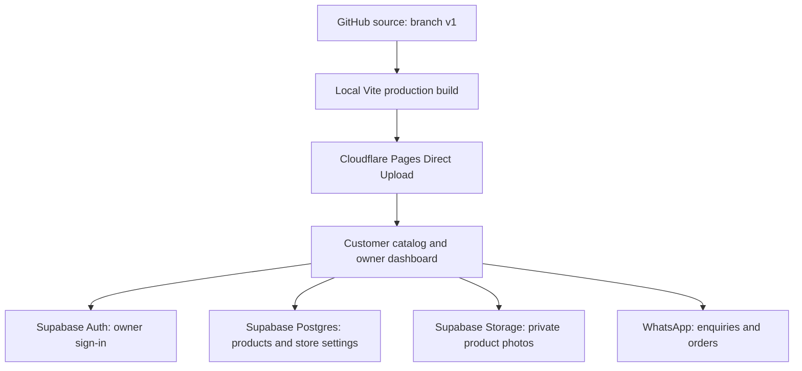

# AAMUKTHA Drapes & Delights

A mobile-focused business catalog with a customer website and a private owner dashboard. Customers browse product photos, prices and availability, then contact the business on WhatsApp. Orders and payments are handled outside this website; there is no cart, checkout or customer registration.

This guide records the setup and work completed through **24 October 2026**.

## Links and accounts

| Purpose                     | Location / name                                                                                            |
| --------------------------- | ---------------------------------------------------------------------------------------------------------- |
| Customer website            | [aamuktha-drapes-and-delights.pages.dev](https://aamuktha-drapes-and-delights.pages.dev/)                  |
| Owner dashboard             | [Owner login](https://aamuktha-drapes-and-delights.pages.dev/admin)                                        |
| GitHub source               | [manjunath4232/myPlayWebsite](https://github.com/manjunath4232/myPlayWebsite/tree/v1)                      |
| Working branch              | `v1`                                                                                                       |
| Hosting provider            | [Cloudflare dashboard](https://dash.cloudflare.com/) → Workers & Pages                                     |
| Cloudflare Pages project    | `aamuktha-drapes-and-delights`                                                                             |
| Supabase dashboard          | [myplay-catalog project](https://supabase.com/dashboard/project/vuyqmeiuuibclgwgicat)                      |
| Supabase organization       | `MyPlay`                                                                                                   |
| Supabase project name       | `myplay-catalog`                                                                                           |
| Supabase public project URL | `https://vuyqmeiuuibclgwgicat.supabase.co`                                                                 |
| Previous website address    | [myplay-catalog-4232.pages.dev](https://myplay-catalog-4232.pages.dev/) — redirects to the current website |

The setup uses Cloudflare Pages and Supabase free plans and a provider-supplied `pages.dev` address. No custom domain has been purchased for this setup. Usage remains subject to each provider's plan limits; a free plan is not an unlimited hosting guarantee.

## Owner quick guide — తెలుగులో

1. పై **Owner dashboard** link తెరవండి. Website owner email, Supabaseలో user సృష్టించినప్పుడు పెట్టిన passwordతో login అవ్వండి.
2. **Add product** నొక్కి photo, పేరు, ధర, category, description ఇవ్వండి. Category dropdownలో ఏడు business categories ఉన్నాయి.
3. **Available now** అంటే ప్రస్తుతం అందుబాటులో ఉంది. **Publish in the customer collection** ఎంచుకుంటే customer websiteలో కనిపిస్తుంది.
4. **Save product** నొక్కండి. Customers page refresh చేసినప్పుడు కొత్త product కనిపిస్తుంది.
5. ఇప్పటికే ఉన్న product దగ్గర edit buttonతో వివరాలు మార్చవచ్చు. Delete చేస్తే product, దాని photo తొలగుతాయి; దానికి బదులు కొంతకాలం దాచాలంటే Publish ఎంపిక తీసేయండి.
6. **Store settings**లో business name, headline, introduction, WhatsApp number మార్చవచ్చు. WhatsApp numberకి country code తప్పనిసరిగా ఇవ్వండి.
7. Website login password, Supabase account password, database password వేర్వేరు. Passwords చాట్‌లో గానీ GitHubలో గానీ పెట్టవద్దు.

Two owner accounts have been authorized. Both have the same management rights over this single business catalog. Their login details are managed privately in Supabase; this README does not list personal owner emails or passwords.

## What was built

### Customer catalog

- Business logo and name in the header and footer; the logo is also the browser tab icon.
- Product photos, name, category, price in Indian rupees and availability.
- Search across product name, category and description.
- Category filters, an in-stock filter and sorting by newest or price.
- A product detail view with a larger photo and description.
- Product-specific WhatsApp enquiry links with the product name and price included in the message. A general WhatsApp contact link is also available.
- Customers do not need an account. Only published products are shown.

### Owner dashboard

- Email/password sign-in through Supabase Auth.
- Explicit owner authorization in addition to sign-in: creating a user alone does not give management access.
- Add, edit and delete products; control availability and publication independently.
- Photo upload with a preview. JPG, PNG and WebP inputs up to 15 MB are accepted, then resized to a maximum dimension of 1,400 px and compressed to WebP. The final file must be no larger than 2 MB.
- Search the owner's products, including hidden products.
- Product counts for total, published and available published products.
- Store settings for business name, headline, introduction and WhatsApp number.
- Login messages distinguish email confirmation, incorrect credentials, rate limits and connection/service failures.

### Business categories

These exact names are defined in `src/data.js` and shared by the owner dropdown and customer filters:

1. Kids Toys & gifts
2. Stationery collection
3. Jute/cloth/pvc/birthday Bags
4. Festive collection
5. Jewellery Organisers
6. Sarees & Blouses
7. Lunch bags

Customer filters include these categories even before products are added. Categories already used by existing products are also retained. A category change in `src/data.js` requires rebuilding and redeploying the frontend; it does not rename categories on existing database rows.

### Mobile UI

- Compact introduction so customers reach the collection with less scrolling.
- Sticky business header and larger touch targets, generally at least 44 px high.
- Search above the category chips; categories scroll sideways on phones.
- Larger, readable product names, prices and form text.
- Two product columns on most phones and one column below 360 px.
- Product images fit inside their frames on phones rather than being cropped to fill them.
- Product details and owner forms open as full-width sheets near the bottom of the screen.
- Price and category fields stack vertically on phones; text-entry fields use 16 px text.
- Tablet and desktop layouts remain available, including the larger decorative hero illustration.

## How the services work together



Cloudflare serves the built HTML, CSS, JavaScript and static assets. The browser talks directly to Supabase using its public project URL and publishable/anon key. Database and Storage policies decide what each visitor or owner may read or change. There is no separate application server to maintain for this version.

WhatsApp opens a prefilled message. The customer still chooses whether to send it. The website does not record an order or process a payment.

## Supabase database and access

The initial schema is tracked in `supabase/schema.sql`.

| Resource                        | Purpose                                                                                            |
| ------------------------------- | -------------------------------------------------------------------------------------------------- |
| `auth.users`                    | Email/password identities managed by Supabase Auth                                                 |
| `public.owners`                 | Explicit list of user IDs allowed to manage this business                                          |
| `public.is_owner()`             | Checks whether the signed-in user belongs to that list                                             |
| `public.products`               | Name, category, price, description, image path, availability, publication status and creation time |
| `public.store_settings`         | One store settings row, with `id = 1`                                                              |
| Storage bucket `product-images` | Private uploaded product photos                                                                    |

Row Level Security is enabled. Visitors can read published products and public store settings. Authorized owners can read hidden products and manage products, photos and store settings. A signed-in account without owner membership cannot manage the catalog.

Photos use signed URLs lasting one hour. The visible app refreshes catalog data every 30 minutes and when returning to the tab. Customers can also refresh the page to fetch changes sooner. A previously issued photo URL may continue to work until it expires after a product is hidden or removed.

### Add another owner

1. Open the project's **Authentication → Users → Add user** flow in Supabase.
2. Create the owner's email/password user. Enter the new website password directly in Supabase. This is not the owner's Gmail password or the project's database password.
3. Ensure the email is confirmed. If confirmation is required, the user must finish it before signing in.
4. Open `supabase/owner-setup.sql`, replace `OWNER_EMAIL` with the exact new user's email, review the intended recipient, and run it in the project's SQL Editor as an administrator.
5. Check the query result and confirm the intended account is in the owner list.
6. Sign in at `/admin` with that email and website password.

Keep public signups disabled for this owner-only setup. Never grant ownership just because someone can create or sign in to an account. Only a trusted administrator should change owner membership.

### Authentication settings used

- Email/password authentication is enabled.
- Public signups are disabled.
- Authentication Site URL is `https://aamuktha-drapes-and-delights.pages.dev`.
- `/admin` is the website's owner sign-in route.
- Both current owners have confirmed emails and were explicitly added to `public.owners`.

If you change the website address, review the Auth Site URL and allowed redirect URLs for confirmation/recovery flows too.

## Local development

Use **Node.js 22.12 or newer**. Node 24 was used for the deployed build. Dependencies and exact installed versions are recorded in `package-lock.json`.

```sh
git clone git@github.com:manjunath4232/myPlayWebsite.git
cd myPlayWebsite
git switch v1
npm ci
cp .env.example .env.local
```

Set these values in the ignored `.env.local` file using the project dashboard:

```dotenv
VITE_SUPABASE_URL=https://YOUR_PROJECT_REF.supabase.co
VITE_SUPABASE_ANON_KEY=YOUR_PUBLIC_PUBLISHABLE_OR_ANON_KEY
```

Then start the development server:

```sh
npm run dev
```

Without both Supabase values, the app displays a read-only sample catalog with local SVG illustrations. Owner management is disabled in that mode. Those sample products are not automatically inserted into the live database.

### Re-create the backend for a different project

1. Create a Supabase organization and project using the intended plan.
2. Run `supabase/schema.sql` once in the **new project's** SQL Editor. It creates tables, policies, the private image bucket and initial store settings. It is not a migration to rerun on the existing live project.
3. Create and authorize the required owner users as described above.
4. Configure authentication and the website URL.
5. Set the new public frontend environment values, build and deploy.
6. Add actual products and store contact details through the owner dashboard.

## Build, GitHub and live deployment

### Current deployment method: Direct Upload

**A GitHub push does not automatically update the live website.** Source code is saved on GitHub; the built files must separately be uploaded to Cloudflare Pages.

1. Save and review the source changes, then commit and push them to `v1`.
2. Confirm the intended public Supabase settings are present in `.env.local`.
3. Build the site:

   ```sh
   npm ci
   npm run build
   ```

4. Package the **contents** of `dist/`, including `_headers`, with `index.html` at the ZIP root. On Linux with `zip` installed:

   ```sh
   cd dist
   zip -r /tmp/aamuktha-site.zip .
   cd ..
   ```

5. In Cloudflare, open **Workers & Pages → aamuktha-drapes-and-delights → Create deployment**.
6. Choose **Production**, upload the ZIP and wait until all files finish uploading.
7. Select **Save and deploy** and confirm the success screen.
8. Open the website and `/admin`; refresh and check the changed features on phone and desktop sizes.

Product and store-setting changes made through the owner dashboard are saved in Supabase and **do not require a frontend deployment**. README-only changes also need only a GitHub push.

### Optional future Git-connected deployment

If the hosting project is migrated to a Git-connected Pages setup, use the GitHub repository and branch `v1`, build command `npm run build`, output directory `dist`, Node 24 and the two public Supabase build variables. Configure that integration explicitly before expecting automatic deployments.

### Website naming and old link

The first site used `myplay-catalog-4232.pages.dev`. A separate Pages project was created for `aamuktha-drapes-and-delights.pages.dev` when the business name was chosen.

The previous project serves a redirect deployment tracked in `deployment/legacy-redirect/`. Its `/*` redirect preserves the path, so the previous `/admin` address also goes to the current `/admin` address. Keep that old deployment if existing shared links should continue to work.

The display name can be changed in Store settings. Changing the hosting address is a separate hosting task; changing the display name does not change the URL.

## Source map

| File / directory                  | What to edit or inspect                                                     |
| --------------------------------- | --------------------------------------------------------------------------- |
| `src/main.jsx`                    | Customer UI, owner sign-in/dashboard, product and store-setting forms       |
| `src/style.css`                   | Brand styling, responsive phone/tablet/desktop layouts                      |
| `src/data.js`                     | Default settings, the seven categories and local preview products           |
| `src/api.js`                      | Supabase access, image compression, product and settings operations         |
| `src/domain.js`                   | Search/filter/sort, validation, currency, WhatsApp links and login messages |
| `public/images/aamuktha-logo.png` | Prepared business logo from the supplied reference                          |
| `public/images/`                  | Logo and local preview illustrations                                        |
| `index.html`                      | Page metadata, favicon reference and app entry point                        |
| `public/_headers`                 | Content Security Policy and other browser security headers                  |
| `supabase/schema.sql`             | Initial database, Storage and permission setup                              |
| `supabase/owner-setup.sql`        | Administrator-reviewed owner authorization helper                           |
| `deployment/legacy-redirect/`     | Previous website address redirect files                                     |
| `.env.example`                    | Public frontend configuration template                                      |
| `tests/domain.test.js`            | Filtering, WhatsApp, validation and sign-in message checks                  |

## Completed work and verification

- Built the catalog and private owner dashboard in the existing GitHub repository.
- Configured the Supabase schema, private photo bucket and owner access policies.
- Deployed to Cloudflare Pages and later published at the chosen business address.
- Added the supplied business logo to the header, footer and browser tab icon.
- Replaced the free-text category field with the seven-category dropdown and customer filters.
- Fixed misleading sign-in messages and completed email confirmation for the initial owner.
- Authorized two confirmed owner accounts.
- Improved the phone browsing, search, touch targets, product details and owner forms.
- Pushed these source changes to GitHub on `v1`.

The existing four automated domain checks and production builds passed during implementation. The phone UI was checked in browser viewports at 320 and 390 px, with tablet and desktop checks at 768 and 1280 px. Search and product details were exercised with local preview products; live owner category selection, product-form sizing and store settings were checked without creating test products. The owner also confirmed successful sign-in and product upload during setup. No concurrency/load benchmark was performed.

Run the existing checks after functional changes:

```sh
npm test
npm run build
```

After permission changes, separately check anonymous and signed-in non-owner access, hidden product/photo access and authorized owner writes. These are backend authorization checks; a successful frontend build alone does not verify them.

## Routine care and troubleshooting

- **A new product is missing:** check that it saved successfully and **Publish in the customer collection** is checked. Clear search/category/stock filters and refresh the customer page.
- **Wrong login details:** use the exact Supabase owner-user email and that user's website password. The Supabase dashboard/account or database password will not sign in to this website.
- **Email not confirmed:** complete the confirmation flow for that user, then sign in again.
- **Owner access required:** an administrator must verify the account's `public.owners` membership.
- **WhatsApp goes to the wrong destination:** save the full international number, including country code, then test the link. The app checks numeric format and length; it cannot verify that a number belongs to the business.
- **Images do not upload:** use JPG/PNG/WebP under 15 MB. Very large images may still exceed the final 2 MB limit after compression. Check service connectivity and owner access.
- **Code changed but the live site did not:** rebuild and Direct Upload the production ZIP. A source push alone is insufficient with the current setup.
- **Photo cleanup fails after product deletion:** the dashboard reports the error. A trusted administrator can review leftover files in the private bucket before removing them.
- **Backups:** keep original product photos and make regular exports of business data. GitHub stores code, not the live product database, Auth users or uploaded product photos.

Keep `.env.local`, database passwords, website passwords, private SSH keys and any Supabase service-role/secret key out of GitHub. Only public project configuration belongs in the frontend build. Browser headers help protect the page, but database and Storage policies enforce data access.
